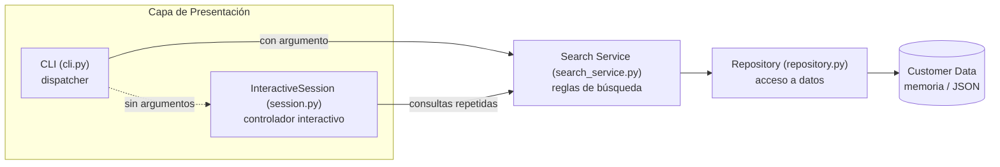

# Architecture 
 
## Overview 
Arquitectura de tres capas, proporcional al alcance de SPEC.md: una interfaz local (CLI o API HTTP local) con soporte para ejecución de un solo disparo y sesión interactiva (FR-11 a FR-15), un servicio que concentra las reglas de búsqueda, y un repositorio que abstrae el acceso a los datos en memoria o JSON. No se introducen colas, cachés ni bases de datos: el volumen (≤ 1 000 clientes) y la ejecución mono-proceso no lo justifican.



## Components 
- **CLI (`customer_search.cli`)**: punto de entrada local y despachador. Parsea argumentos de entrada; si recibe una consulta ejecuta la búsqueda de un solo disparo; si no recibe argumentos, inicia la sesión interactiva (FR-11, FR-15).
- **Formatting (`customer_search.formatting`)**: función `format_output` de la capa de presentación que traduce cada `SearchResult` (`OK`, `EMPTY_QUERY`, `NO_RESULTS`) a texto. La comparten la CLI y `InteractiveSession`, de modo que ninguno de los dos módulos depende del otro para formatear.
- **InteractiveSession (`customer_search.session`)**: controlador de sesión interactiva. Gestiona el ciclo REPL en terminal: muestra el banner de bienvenida con instrucciones de salida (`:salir`, `:exit`), solicita entradas repetidas con el prompt `"Buscar cliente: "`, filtra comandos de salida y señales de terminal (`KeyboardInterrupt`, `EOFError`), e invoca al `SearchService` mostrando resultados formateados sin abortar la sesión (FR-11 a FR-14, SR-10 a SR-14).
- **Search Service (`customer_search.search_service`)**: aplica normalización, coincidencia, orden, truncamiento y proyección de campos. Es el único componente con reglas de negocio.
- **Repository (`customer_search.repository`)**: expone el catálogo completo de clientes al Search Service, sin conocer reglas de búsqueda.
- **Customer Data**: almacenamiento en memoria o archivo JSON local (C-02).
 
## Responsibilities 
- **CLI (`cli.py`)**: parsear argumentos mediante `argparse`, detectar presencia/ausencia de consulta, despachar a búsqueda de un solo disparo o delegar en `InteractiveSession.run()`.
- **Formatting (`formatting.py`)**: presentar `SearchResult` como texto (`format_output`); sin reglas de negocio.
- **InteractiveSession (`session.py`)**: ciclo REPL (SR-10, SR-12), banner e instrucciones de salida (SR-11), validación de comandos `:salir` y `:exit` (VR-04, SR-14, A-12), captura limpia de interrupciones de terminal (EH-05), invocación a `SearchService.search` y presentación de resultados preservando la sesión ante `EMPTY_QUERY` y `NO_RESULTS` (SR-13).
- **Search Service**: SR-01 a SR-09 (unión sin duplicados, subcadena, normalización, trim, consulta vacía, truncamiento a 50, orden con desempate, alcance único, proyección de campos), EH-01 y EH-02 (consulta vacía y sin resultados).
- **Repository**: `find_all()` sobre Customer Data; no filtra, no ordena, no normaliza.
- **Customer Data**: persistir y devolver registros crudos; no valida reglas de búsqueda.
 
## Data Flow 
**1. Modo de un solo disparo (con argumento, FR-15):**
1. El usuario ejecuta `python -m customer_search.cli "<query>"`.
2. La CLI pasa la consulta cruda a `SearchService.search(query)`.
3. Search Service recorta espacios (SR-04); si el resultado es vacío, aplica EH-01 y retorna sin consultar el Repository.
4. Search Service pide el catálogo completo al Repository (`find_all()`).
5. Search Service normaliza consulta y campos (SR-03), filtra por subcadena (SR-02) en nombre y email, y deduplica por `cliente_id` (SR-01).
6. Search Service ordena (SR-07) y trunca a 50 con total informado (SR-06).
7. Search Service proyecta cada resultado a {cliente_id, nombre, email} (SR-09); si el conjunto es vacío aplica EH-02, poblando `status = "NO_RESULTS"` y `message` con la constante del servicio.
8. La CLI recibe el resultado, formatea la salida con `format_output` (`formatting.py`) y finaliza con código 0.

**2. Modo interactivo (sin argumentos, FR-11 a FR-14):**
1. El usuario ejecuta `python -m customer_search.cli` sin argumentos.
2. La CLI detecta la ausencia de argumento e invoca `InteractiveSession(service=search_service).run()`.
3. `InteractiveSession` imprime el banner de bienvenida con instrucciones explícitas de salida (`:salir`, `:exit`).
4. `InteractiveSession` entra en ciclo solicitando la consulta con el prompt `"Buscar cliente: "`.
5. Si la entrada es un comando de salida (`:salir` o `:exit`, A-12) o se produce una señal de terminal (`KeyboardInterrupt`, `EOFError`), finaliza limpiamente la sesión sin consultar `SearchService`.
6. Si es un término de búsqueda, delega en `SearchService.search(query)`, imprime el resultado formateado y repite el ciclo (permaneciendo activa ante `EMPTY_QUERY` o `NO_RESULTS`).
 
## Interfaces 
```python
class SearchService:
    def search(self, query: str) -> SearchResult: ...
 
@dataclass
class SearchResult:
    items: list[CustomerView]   # máx. 50, proyectados (FR-10)
    total: int                  # total real de coincidencias (FR-07)
    status: str                 # "OK" | "EMPTY_QUERY" | "NO_RESULTS"
    message: str | None = None  # mensaje fijo; solo poblado en NO_RESULTS (FR-06, EH-02)

@dataclass
class CustomerView:
    cliente_id: str
    nombre: str
    email: str
 
class CustomerRepository:
    def find_all(self) -> list[Customer]: ...

class InteractiveSession:
    def __init__(
        self,
        service: SearchService,
        input_fn: Callable[[str], str] | None = None,   # None → builtins.input
        output_fn: Callable[[str], None] | None = None, # None → builtins.print
    ) -> None: ...
    def run(self) -> None: ...
    def handle_input(self, raw_input: str) -> bool: ...
    def is_exit_command(self, text: str) -> bool: ...
```
El repositorio devuelve entidades `Customer` completas; Search Service es responsable de proyectarlas a `CustomerView` antes de devolverlas a la interfaz, de modo que ningún campo fuera de la lista blanca cruce esa frontera.
 
## Error Handling 
La lógica de negocio y validación de consultas vive en Search Service, mientras que el control de terminal reside en la capa de presentación:
- Consulta vacía o solo espacios → `status = "EMPTY_QUERY"`, `items = []`, sin invocar al Repository (EH-01). En sesión interactiva, se despliega el mensaje informativo y la sesión continúa (FR-13, SR-13).
- Consulta sin coincidencias → `status = "NO_RESULTS"`, `items = []`, mensaje fijo tomado de una constante del servicio (EH-02). En sesión interactiva, se despliega el mensaje y la sesión continúa (FR-13, SR-13).
- Interrupción o fin de archivo en terminal → `KeyboardInterrupt` y `EOFError` son capturados limpiamente por `InteractiveSession`, cerrando el bucle interactivo sin trazas de excepción ni código de error (EH-05, FR-14).
- No hay manejo de errores de autenticación, TLS o rate limiting: no existen esos componentes en esta arquitectura (EH-03, EH-04 de SPEC.md, N/A por C-05).
 
## Testing Strategy 
- **Unit — Search Service**: normalización (diacríticos/case), subcadena en cualquier posición, deduplicación, trim de espacios, consulta vacía, truncamiento a 50 con total correcto, orden y desempate por `cliente_id`, proyección de campos.
- **Unit — Repository**: lectura/escritura contra el backend en memoria o JSON (C-02), incluyendo dataset vacío y dataset en el límite de C-08.
- **Unit — InteractiveSession (`tests/test_session.py`)**: pruebas unitarias aisladas inyectando simulaciones de `input_fn` y `output_fn` (sin monkeypatching global). Verifican banner, comandos de salida (`:salir`, `:exit`, insensible a mayúsculas y con espacios), tolerancia a `EMPTY_QUERY`/`NO_RESULTS` sin salir, y captura limpia de `EOFError` y `KeyboardInterrupt` (AC-15 a AC-19).
- **Integration — CLI (`tests/test_cli.py`)**: verificación de que la invocación sin argumentos despacha a `InteractiveSession` (AC-14), mientras que la invocación con argumentos preserva la ejecución de un solo disparo existente.
- **Latencia (NFR-01 / AC-08)**: prueba separada, no unitaria, que ejecuta consultas secuenciales sobre 1 000 clientes y mide p95/p99.
 
## Dependencies 
Librería estándar de Python (`unicodedata` para remover diacríticos, `json` para persistencia) más `pytest` para pruebas (C-01, C-03). Ninguna dependencia de terceros para producción.
 
## Design Decisions 
- La normalización, el orden, el truncamiento y la proyección de campos viven en Search Service, no en el Repository ni en la interfaz: mantiene la lógica de negocio testable de forma aislada, independiente del almacenamiento y de la presentación.
- FR-09 se implementa como "sin filtrado" (Search Service siempre consulta el catálogo completo): es la traducción fiel de su forma degenerada en SPEC.md (A-07, alcance único). El punto de extensión para una autorización real por rol quedaría en Search Service, antes de la proyección, sin tocar Repository ni interfaz.
- La proyección de campos (FR-10) se aplica en Search Service y no en la interfaz, para que la lista blanca se cumpla sin importar cuántas interfaces (CLI, API) consuman el servicio.
- La sesión interactiva se aísla en un controlador dedicado (`InteractiveSession` en `session.py`) dentro de la capa de presentación: permite inyectar callables para `input_fn` y `output_fn`, facilitando pruebas unitarias limpias y deterministas sin monkeypatching global y sin alterar las capas de dominio, servicio o repositorio.
 
## Trade-offs
- Consultar siempre el catálogo completo (`find_all()`) es simple y suficiente para ≤ 1 000 clientes (C-08), pero no escala a volúmenes mayores sin introducir indexado — decisión aceptable dado el alcance actual y explícitamente fuera de este incremento.
- Concentrar toda la lógica en Search Service facilita las pruebas unitarias pero lo convierte en un componente más grande; se acepta porque el alcance es una sola feature y no justifica dividirlo en más colaboradores.
- No hay capa de autenticación/autorización real (solo el punto de extensión señalado en Design Decisions): correcto para C-05, pero implica que reactivar FR-09 en su forma completa requerirá revisar Search Service y posiblemente el Repository. 