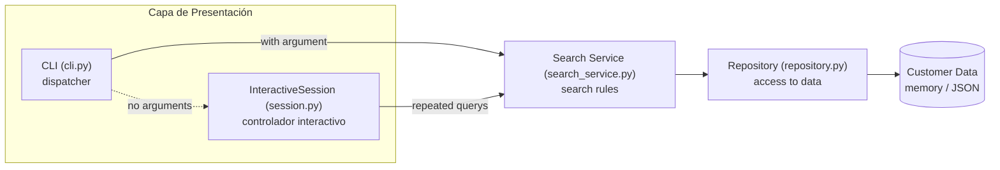

# Architecture 
 
## Overview 
A three-layer architecture, aligned with the scope defined in SPEC.md: a local interface (CLI or local HTTP API) supporting both single-execution and interactive session modes (FR-11 through FR-15); a service that centralizes search rules; and a repository that abstracts data access, whether from in-memory storage or JSON files. No queues, caches, or databases are included, as the scale (≤ 1,000 clients) and single-process execution do not warrant them.



## Components
- **CLI (`customer_search.cli`)**: Local entry point and dispatcher. It parses input arguments; if a query is provided, it executes a one-off search, whereas if no arguments are provided, it initiates an interactive session (FR-11, FR-15).
- **Formatting (`customer_search.formatting`)**: Contains the `format_output` function (part of the presentation layer), which translates each `SearchResult` (`OK`, `EMPTY_QUERY`, `NO_RESULTS`) into text. This is shared by both the CLI and `InteractiveSession`, ensuring that neither module depends on the other for formatting.
- **InteractiveSession (`customer_search.session`)**: An interactive session controller. It manages the REPL cycle in the terminal: displaying a welcome banner with exit instructions (`:salir`, `:exit`), repeatedly prompting for input with `"Buscar cliente: "`, filtering out exit commands and terminal signals (`KeyboardInterrupt`, `EOFError`), and invoking the `SearchService` to display formatted results without terminating the session (FR-11 to FR-14, SR-10 to SR-14).
- **Search Service (`customer_search.search_service`)**: Handles normalization, matching, ordering, truncation, and field projection. This is the only component that contains business logic.
- **Repository (`customer_search.repository`)**: Exposes the complete catalog of customers to the `SearchService`, without any knowledge of search rules.
- **Customer Data**: Stored either in-memory or in a local JSON file (C-02).

## Responsibilities
- **CLI (`cli.py`)**: Parses arguments using `argparse`, detects the presence or absence of a query, and either dispatches a one-off search or delegates execution to `InteractiveSession.run()`.
- **Formatting (`formatting.py`)**: Presents `SearchResult` objects as text (via `format_output`); contains no business logic. - **InteractiveSession (`session.py`)**: REPL loop (SR-10, SR-12), banner and exit instructions (SR-11), validation of `:salir` and `:exit` commands (VR-04, SR-14, A-12), clean handling of terminal interrupts (EH-05), invocation of `SearchService.search`, and presentation of results while maintaining the session state in the event of `EMPTY_QUERY` or `NO_RESULTS` (SR-13).
- **Search Service**: SR-01 through SR-09 (deduplication, substring matching, normalization, whitespace trimming, handling empty queries, truncation to 50 results, sorting with tie-breaking, single-scope search, and field projection), plus EH-01 and EH-02 (handling empty queries and cases with no results).
- **Repository**: `find_all()` on Customer Data; performs no filtering, sorting, or normalization.
- **Customer Data**: Persists and returns raw records; does not validate search rules.

## Data Flow
**1. Single-shot mode (with argument, FR-15):**
1. The user executes `python -m customer_search.cli "<query>"`.
2. The CLI passes the raw query to `SearchService.search(query)`.
3. The Search Service trims whitespace (SR-04); if the result is empty, it triggers EH-01 and returns without querying the Repository.
4. The Search Service requests the complete catalog from the Repository (`find_all()`).
5. The Search Service normalizes the query and fields (SR-03), filters by substring (SR-02) within the name and email fields, and removes duplicates based on `cliente_id` (SR-01).
6. The Search Service sorts the results (SR-07), truncates the list to 50 entries, and provides the total count (SR-06). 7. The Search Service maps each result to `{cliente_id, name, email}` (SR-09); if the set is empty, it applies EH-02, setting `status = "NO_RESULTS"` and populating `message` with the service's defined constant.
8. The CLI receives the result, formats the output using `format_output` (from `formatting.py`), and terminates with an exit code of 0.

**2. Interactive mode (no arguments, FR-11 to FR-14):**
1. The user executes `python -m customer_search.cli` without any arguments.
2. The CLI detects the absence of arguments and invokes `InteractiveSession(service=search_service).run()`.
3. `InteractiveSession` displays a welcome banner with explicit instructions on how to exit (`:salir`, `:exit`).
4. `InteractiveSession` enters a loop, requesting a query via the prompt `"Buscar cliente: "`.
5. If the input is an exit command (`:salir` or `:exit`, A-12) or a terminal signal occurs (`KeyboardInterrupt`, `EOFError`), the session terminates cleanly without querying the `SearchService`.
6. If the input is a search term, it delegates the request to `SearchService.search(query)`, prints the formatted result, and repeats the loop (remaining active even in the event of `EMPTY_QUERY` or `NO_RESULTS`).
 
## Interfaces 
```python
class SearchService:
    def search(self, query: str) -> SearchResult: ...
 
@dataclass
class SearchResult:
    items: list[CustomerView]   # máx. 50, proyectados (FR-10)
    total: int                  # total real de coincidencias (FR-07)
    status: str                 # "OK" | "EMPTY_QUERY" | "NO_RESULTS"
    message: str | None = None  # mensaje fijo; solo poblado en NO_RESULTS (FR-06, EH-02)

@dataclass
class CustomerView:
    cliente_id: str
    nombre: str
    email: str
 
class CustomerRepository:
    def find_all(self) -> list[Customer]: ...

class InteractiveSession:
    def __init__(
        self,
        service: SearchService,
        input_fn: Callable[[str], str] | None = None,   # None → builtins.input
        output_fn: Callable[[str], None] | None = None, # None → builtins.print
    ) -> None: ...
    def run(self) -> None: ...
    def handle_input(self, raw_input: str) -> bool: ...
    def is_exit_command(self, text: str) -> bool: ...
```
The repository returns complete `Customer` entities; the Search Service is responsible for projecting them into `CustomerView` objects before returning them to the interface, ensuring that no fields outside the allowlist cross this boundary.

## Error Handling
Business logic and query validation reside within the Search Service, while terminal control resides in the presentation layer:
- Empty or whitespace-only query → `status = "EMPTY_QUERY"`, `items = []`, without invoking the Repository (EH-01). In an interactive session, an informational message is displayed, and the session continues (FR-13, SR-13).
- Query with no matches → `status = "NO_RESULTS"`, `items = []`, with a fixed message retrieved from a service constant (EH-02). In an interactive session, the message is displayed, and the session continues (FR-13, SR-13).
- Terminal interruption or end-of-file → `KeyboardInterrupt` and `EOFError` are handled gracefully by `InteractiveSession`, terminating the interactive loop without displaying exception traces or error codes (EH-05, FR-14).
- Authentication, TLS, or rate-limiting errors are not handled, as these components do not exist within this architecture (EH-03, EH-04 from SPEC.md; N/A per C-05).

## Testing Strategy
- **Unit — Search Service**: normalization (diacritics/case), substring matching at any position, deduplication, whitespace trimming, empty queries, truncation to 50 items (with the correct total count), sorting (including tie-breaking by `cliente_id`), and field projection.
- **Unit — Repository**: read/write operations against an in-memory or JSON backend (C-02), covering scenarios such as an empty dataset and a dataset at the limit defined by C-08. - **Unit — `InteractiveSession` (`tests/test_session.py`)**: Isolated unit tests using injected mocks for `input_fn` and `output_fn` (avoiding global monkeypatching). These verify the banner, exit commands (case-insensitive `:salir` and `:exit`, including handling of extra spaces), robust handling of `EMPTY_QUERY`/`NO_RESULTS` (without exiting), and clean capture of `EOFError` and `KeyboardInterrupt` (AC-15 through AC-19).
- **Integration — CLI (`tests/test_cli.py`)**: Verifies that invoking the CLI without arguments triggers `InteractiveSession` (AC-14), while invocation with arguments preserves the existing "single-shot" execution behavior.
- **Latency (NFR-01 / AC-08)**: A separate (non-unit) test that executes sequential queries across 1,000 clients and measures p95/p99 latency.

## Dependencies
Uses the Python standard library (`unicodedata` for diacritic removal, `json` for persistence) and `pytest` for testing (C-01, C-03). There are no third-party dependencies for production.

## Design Decisions
- Normalization, ordering, truncation, and field projection are handled within the Search Service—not in the Repository or the interface layer. This ensures that business logic remains independently testable, decoupled from both the storage layer and the presentation layer.
- FR-09 is implemented as "no filtering" (the Search Service always queries the entire catalog), which is the direct interpretation of its degenerate form as defined in `SPEC.md` (A-07, single scope). Future implementation of role-based authorization would be integrated into the Search Service—prior to field projection—without requiring changes to the Repository or the interface. - Field projection (FR-10) is implemented within the Search Service rather than at the interface level; this ensures the allowlist is enforced regardless of which interface (CLI, API) consumes the service.
- The interactive session is isolated within a dedicated controller (`InteractiveSession` in `session.py`) in the presentation layer. This allows for the injection of callables for `input_fn` and `output_fn`, facilitating clean, deterministic unit testing without the need for global monkeypatching or modifications to the domain, service, or repository layers.

## Trade-offs
- Querying the entire catalog (`find_all()`) is simple and sufficient for ≤ 1,000 clients (C-08), though it will not scale to larger volumes without the introduction of indexing—a decision deemed acceptable given the current scope, which explicitly excludes such scaling.
- Consolidating all logic within the Search Service simplifies unit testing but results in a larger component; this is acceptable, as the scope is limited to a single feature and does not justify splitting the logic across additional collaborating components.
- There is no full-fledged authentication/authorization layer (only the extension point noted in the Design Decisions); while this suffices for C-05, it means that fully re-enabling FR-09 would require revisions to the Search Service and, potentially, the Repository.