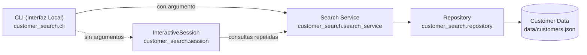

# Customer Search Feature (`ada-05-spec-driven-feature`)

Implementación local de la funcionalidad de búsqueda de clientes por nombre o correo electrónico, desarrollada con arquitectura guiada por especificación (Spec-Driven Development).

---

## 1. Descripción y Arquitectura

El sistema implementa una arquitectura desacoplada de tres capas conforme a [ARCHITECTURE.md](file:///C:/Users/ItzKe/Documents/9no_Semestre/Ingenieria%20asistida%20con%20IA/ada-05-spec-driven-feature/ada-05-spec-driven-feature/ARCHITECTURE.md):



- **CLI (`customer_search.cli`)**: Punto de entrada de línea de comandos y despachador. Con un argumento ejecuta una búsqueda de un solo disparo (FR-15); sin argumentos inicia la sesión interactiva (FR-11). Formatea la salida de resultados y estados (`OK`, `EMPTY_QUERY`, `NO_RESULTS`).
- **InteractiveSession (`customer_search.session`)**: Controlador de la sesión interactiva (REPL). Muestra el banner de bienvenida con los comandos de salida, solicita consultas con el prompt `Buscar cliente: `, permanece activa ante `EMPTY_QUERY`/`NO_RESULTS` y finaliza con `:salir`, `:exit`, Ctrl+C o fin de archivo (FR-12 a FR-14).
- **Search Service (`customer_search.search_service`)**: Concentra toda la lógica de negocio:
  - Normalización de texto y eliminación de diacríticos (`customer_search.normalization`).
  - Búsqueda simultánea sobre nombre y email con coincidencia por subcadena sin duplicados (FR-01, FR-02).
  - Truncamiento a 50 resultados con reporte del total real (FR-07).
  - Ordenamiento determinista en 3 niveles de coincidencia con desempate alfabético e ID (FR-08).
  - Proyección de resultados a la lista blanca (`CustomerView`: `cliente_id`, `nombre`, `email`) (FR-10).
  - Manejo de consultas vacías y sin resultados con mensajes fijos (FR-05, FR-06).
- **Customer Repository (`customer_search.repository`)**: Abstrae la lectura de los clientes desde almacenamiento JSON (`data/customers.json`) sin aplicar filtros, orden ni normalización.

---

## 2. Instalación

Requiere **Python 3.11+** y `pytest`.

```powershell
# Clonar o ubicarse en la raíz del repositorio
# Instalar el paquete en modo editable
pip install -e .
```

---

## 3. Uso de la Interfaz (CLI)

Ejecutar la interfaz de línea de comandos mediante el módulo `customer_search.cli`.

### 3.1 Modo de un solo disparo (con argumento)

```powershell
# 1. Búsqueda por coincidencia parcial en nombre
python -m customer_search.cli "carlos"

# 2. Búsqueda insensible a mayúsculas y diacríticos (á, é, í, ó, ú, ü, etc.)
python -m customer_search.cli "JOSÉ"
python -m customer_search.cli "jose"

# 3. Búsqueda por coincidencia en correo electrónico
python -m customer_search.cli "special"

# 4. Búsqueda con espacios al inicio y final (recortados automáticamente)
python -m customer_search.cli "   ana   "

# 5. Consulta vacía o solo espacios (devuelve estado EMPTY_QUERY sin ejecutar búsqueda)
python -m customer_search.cli "   "

# 6. Búsqueda sin coincidencias (devuelve estado NO_RESULTS con mensaje fijo)
python -m customer_search.cli "termino_inexistente"
```

### 3.2 Modo interactivo (sin argumentos)

Al ejecutar la CLI sin argumentos se inicia una sesión interactiva que solicita términos de búsqueda de forma repetida (FR-11 a FR-14):

```powershell
python -m customer_search.cli
```

```text
Bienvenido a buscador de clientes
Comandos de salida disponibles: :salir, :exit (o Ctrl+C / Ctrl+D)
Buscar cliente: carlos
Total de coincidencias: 41
Mostrando 41 resultados:
----------------------------------------
[CUST-0129] Carlos Agüero <carlos.aguero129@empresa.es>
...
Buscar cliente: :salir
```

- Cada término se procesa con las mismas reglas que el modo de un solo disparo (FR-01 a FR-10).
- Una consulta vacía (`EMPTY_QUERY`) o sin coincidencias (`NO_RESULTS`) muestra su mensaje y la sesión sigue activa.
- La sesión termina con `:salir` o `:exit` (insensibles a mayúsculas/minúsculas y a espacios en los extremos), con Ctrl+C, o con fin de archivo (Ctrl+D en Linux/macOS, Ctrl+Z + Enter en Windows). Cualquier otro texto, aunque contenga "salir" o "exit", se busca como término normal (A-12).

---

## 4. Ejecución de Pruebas

La suite de pruebas automatizadas está construida con `pytest`:

```powershell
# Ejecutar todas las pruebas unitarias y de integración
pytest -v

# Ejecutar únicamente la prueba de latencia con reporte en consola (NFR-01 / AC-08)
pytest tests/test_latency.py -v -s

# Ejecutar pruebas específicas de normalización y servicio
pytest tests/test_normalization.py tests/test_search_service.py -v

# Ejecutar pruebas de la CLI (incluye el despacho a sesión interactiva, AC-14)
pytest tests/test_cli.py -v

# Ejecutar pruebas de la sesión interactiva (AC-15 a AC-19)
pytest tests/test_session.py -v
```


## 6. Checklist de Revisión Humana (Fase 10)

- **¿El código cumple con REQUIREMENTS.md y SPEC.md?**
  **Sí.** Se verificaron todos los requisitos funcionales FR-01 a FR-15 y el requisito no funcional NFR-01 mediante pruebas automatizadas (AC-01 a AC-19). NFR-02 y NFR-03 quedaron explícitamente fuera de alcance según C-05.
- **¿SPEC.md referencia sin redefinir requisitos?**
  **Sí.** SPEC.md toma las definiciones exactas de REQUIREMENTS.md sin alterar su semántica ni inventar nuevos comportamientos.
- **¿Se inventaron reglas de negocio fuera de la especificación?**
  **No.** Todas las reglas implementadas (SR-01 a SR-14, VR-01 a VR-04, EH-01, EH-02 y EH-05) provienen de SPEC.md y las decisiones documentadas en REQUIREMENTS.md (Q-01 a Q-16, A-12).
- **¿ARCHITECTURE.md coincide con el código implementado?**
  **Sí.** La separación en tres capas (CLI local como despachador e `InteractiveSession` en la capa de presentación, SearchService, CustomerRepository y JSON fixture) y las interfaces (`Customer`, `CustomerView`, `SearchResult`, `CustomerRepository`, `SearchService`, `InteractiveSession`) coinciden con la arquitectura diseñada.